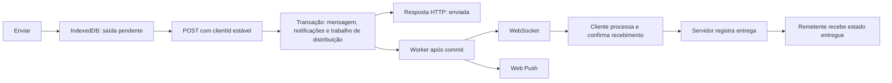

# Plano de implementação — notificações e experiência social

Data: 2026-10-04. Status: **planejado; implementação pendente**.

Este plano atende aos quatro problemas relatados: notificações que não aparecem, espaçamento insuficiente, comentários/respostas com navegação desconfortável e falta de uma saída clara em algumas telas. Inclui também o escopo confirmado depois: push com o app fechado, fila persistente de envio, confirmação real de entrega e distribuição assíncrona. Complementa o [PLAN.md](PLAN.md#36-revisão-da-experiência-social-2026-10-04); a implementação local é acompanhada na Phase 11 do [IMPLEMENTATION.md](IMPLEMENTATION.md#phase-11--notificações-e-experiência-social).

## 1. Resultado esperado e escopo

A pessoa deve perceber uma interação recebida, abrir exatamente o conteúdo correspondente, comentar ou responder sem perder o contexto e retornar ao ponto de origem. Chat, formulários e áreas de interação devem ter margens consistentes, inclusive com o teclado aberto.

Escopo confirmado pelo usuário:

- Corrigir notificações **dentro do aplicativo** e implementar **push com o aplicativo fechado**. O projeto atual não possui service worker; sua introdução faz parte desta entrega.
- Nos posts, comentários são públicos conforme as permissões existentes. Nos stories, melhorar as **respostas privadas**, sem introduzir comentários públicos.
- Persistir a fila de saída no dispositivo e reenviar automaticamente; substituir entrega inferida do socket por confirmação do cliente; retirar a distribuição da requisição HTTP.
- Manter a ressincronização por **refetch completo** na escala atual. Sequência por conversa e sincronização incremental ficam fora desta fase.
- Incluir os bugs adicionais relatados: follow deve alterar Feed e bandeja de stories; fechar stories deve estar sempre disponível; indicador de digitação deve funcionar de forma consistente. Correções prioritárias e independentes na seção 10.
- A referência de experiência é a familiaridade de redes sociais: mídia e conversa no mesmo contexto, campo de escrita acessível, retorno previsível. Preservar a identidade visual e os recursos de tradução do TENNO TALK.

## 2. Diagnóstico no código

Inspeção estática do repositório, sem reprodução em produção ou validação visual no navegador nesta etapa. As lacunas abaixo estão presentes no código; a primeira etapa de execução deve relacioná-las aos sintomas em duas contas reais de teste.

| Área | Evidência | Consequência / verificação necessária |
|---|---|---|
| Mensagens e sino | `ChatService.afterInsert` publica `MessageCreated`; `ChatRealtime` envia `message.created`, mas não há criação de `new_message` nesse fluxo. O tipo existe em `NotificationService` e na UI. | Mensagem recebida pode atualizar Chats sem aparecer na central ou no sino. Respostas privadas a stories passam pelo mesmo envio. |
| Continuidade do realtime | `ShellRoute` monta a conexão e os assinantes. A rota de stories está fora dele; no mobile não há rota de fundo mantendo o shell. | Abrir stories no mobile desmonta a conexão. Mover seu ciclo de vida para o escopo autenticado. |
| Leitura de notificações | `NotificationsPage` chama `markAllRead` ao receber itens não lidos. O hook zera o contador otimisticamente, não restaura no erro e invalida apenas a lista. | Pode esconder pendências, consumir notificações que acabaram de chegar e repetir tentativas após falha. |
| Destinos | `NotificationsPage.open` só distingue mensagem e follow; os outros tipos abrem o próprio perfil. | Curtida/comentário/reação não levam ao conteúdo de origem. |
| Visibilidade no mobile | O sino existe no Feed; a bottom nav só recebe o contador de Chats. | Fora do Feed, atividades sociais não têm um acesso igualmente evidente. |
| Comentários de posts | `PostsGrid` abre um `Dialog` com `PostCard` e, depois, outro `CommentsPanel`; no desktop ele também é `Dialog`. | Empilhamento de janelas, mídia separada da conversa e fechamento confuso. |
| Envio de comentário | `CommentsBody` usa campo de uma linha, sem estado local de erro da lista. `useAddComment` só insere o comentário após sucesso. | Pouco espaço para escrever e feedback insuficiente em rede lenta/falhas. |
| Stories | `StoryReplyBar` já responde dentro do viewer; não existe comentário público. O timer pausa por foco, mas vídeo não recebe esse estado; o campo perde foco ao interagir com outros controles. | A interação pode continuar avançando durante uma resposta. Investigar também o percurso de entrada/saída que produz a sensação de cards. |
| Espaçamento | `pb-safe` define apenas `env(safe-area-inset-bottom)`; há combinações com `p-3`/`pb-4` nos comentários, stories e onboarding. | Possível sobrescrita do espaço mínimo quando o inset é zero. Confirmar estilo computado; não atribuir todo o problema a uma classe sem medir. |
| Voltar | Feed/Discover não fornecem `onBack`; perfil próprio mobile o omite; notificações só o exibem no mobile. Várias telas usam `navigate(-1)` sem destino alternativo. O loading dos stories não oferece fechar. | Comportamento inconsistente, especialmente por link direto, recarregamento e histórico externo. |
| Cobertura | Há testes do badge com dados mock e testes HTTP de notificações sociais. `NotificationsIT` não exercita criação de notificação por envio de mensagem. | Os testes atuais não demonstram o fluxo completo que falha para o usuário. |
| Fila de saída | `failedSends` é um `Map` em memória; `useSendMessage` limpa o composer na mutação. O draft persiste, mas a mensagem enviada/pendente não. `uploadedByClientId` também está em memória. | Recarregar perde pendências e referências de upload; só persistir o Query não resolve o ciclo de envio. |
| Confirmação de entrega | `ChatRealtime.onCreated` chama `markDelivered` após `hub.send`. `ChatService.conversations` também avança entrega ao preparar a lista. | Nenhum dos caminhos comprova processamento pelo cliente; ambos precisam mudar. |
| Distribuição | O listener `AFTER_COMMIT` de `ChatRealtime` percorre membros e recibos de forma síncrona. | O POST espera distribuição; grupos e clientes lentos ampliam o custo. |
| Recibos fora de ordem | `messageCache.applyReceipt` pode promover todas as mensagens quando não encontra o cursor; `setReceipt` promove a última mensagem sem comparar o limite. | Ao tornar a entrega assíncrona, recibos antigos não podem marcar mensagens posteriores como entregues/lidas. |
| Follow e distribuição | `FeedService.feed` passa filtro `TRUE`; `StoryService.tray` usa apenas `Visibility.authorVisible`. Os mocks também filtram somente acesso ao conteúdo. | Todo autor público elegível entra no Feed/bandeja, mesmo sem follow. Permissão de acesso foi usada como regra de distribuição. |
| Cache após follow | `useFollowToggle` atualiza perfis e invalida `me`, sem atualizar Feed/stories. | Mesmo com filtro corrigido no servidor, a tela pode continuar mostrando o conteúdo antigo após seguir/deixar de seguir. |
| Fechar stories | `StoryViewer` já contém botão X de 36 px no header carregado; `StoryViewerPage` retorna tela preta sem fechar durante loading. | Ausência no loading confirmada. Invisibilidade/corte no viewer carregado é hipótese a reproduzir, incluindo nomes longos, flex shrink, safe area e versão publicada. |
| Digitação e conexão | `useTypingEmitter` marca `typing.current = true` mesmo se `WsRealtimeClient.send` descartar o envio por socket fechado; não há reemissão no reconnect. | Pode perder o primeiro sinal e atrasar/omitir o indicador; é um caminho de falha identificado, não diagnóstico único do sintoma. |

### 2.1 Fluxo alvo

Aceitação pelo serviço de push, escrita no socket e confirmação de recebimento são eventos distintos. Somente o último autoriza o estado de entrega; leitura continua dependendo da mensagem visível.

## 3. Notificações confiáveis — prioridade P0

### Comportamento

- Uma interação elegível gera uma notificação persistida para cada destinatário, sem notificar o autor. Mensagens diretas, de grupo e respostas privadas de stories entram nessa regra.
- Chats conta mensagens não lidas; o sino conta atividades não lidas. São contadores distintos. Ler a conversa também resolve as notificações das mensagens efetivamente lidas; abrir a central não envia recibo de leitura da conversa.
- Preferências de categoria e conversas silenciadas controlam avisos. Proposta: conversa silenciada continua contando em Chats, mas não gera `new_message` no sino nem banner. Reutilizar as restrições de privacidade/bloqueio existentes e testá-las explicitamente.
- Remover a leitura automática de toda a central ao abrir. Marcar individualmente após abrir o item e oferecer `Mark all as read` como ação explícita. Conteúdo removido/expirado tem estado informativo e saída disponível.
- Exibir `1`, quantidades maiores e `99+`; zero oculta o badge. O nome acessível do botão inclui a quantidade. No mobile, reutilizar um botão de notificações nos headers de Chats, Discover, Feed e perfil próprio; no desktop, manter o rail.
- Mostrar aviso discreto e acionável enquanto o app está visível, deduplicado por ID. Suprimir o aviso da conversa já aberta e visível; o recibo de leitura resolve seu contador. Não roubar foco nem mostrar uma sequência de banners para eventos recuperados na reconexão.

### Implementação

1. Reproduzir mensagem, curtida, comentário, follow e reação com duas contas e preferências conhecidas. Rastrear: ação → registro no banco → evento após commit → cache → contador → destino. Separar erro de criação, entrega e renderização.
2. Criar notificações de mensagem na transação de inserção, antes da publicação após commit. Reenvio do mesmo `clientId` não pode gerar outra notificação. Garantir unicidade por destinatário/mensagem no banco e paridade no mock; não depender de um socket conectado para persistir.
3. Extrair a conexão e os assinantes para um componente autenticado estável, acima das rotas de shell e stories, montado uma única vez. Evitar montar uma segunda conexão na árvore de overlays. Encerrar no logout/troca de conta e limpar caches do usuário anterior.
4. Centralizar reconciliação de notificações no Query. Invalidação de lista/contador em eventos e reconexão; refetch no retorno à aba. Erro de leitura deve preservar/restaurar o contador e oferecer nova tentativa, sem ciclo automático de mutações.
5. Adicionar leitura individual idempotente e evento `notifications.read` para sincronizar abas/dispositivos do mesmo usuário. Estender `read-all` com limite do lote observado (cursor estável de data + ID), para não consumir uma notificação criada durante a requisição. Retornar/refazer a contagem autoritativa após a mutação.
6. Integrar leitura de conversa às notificações correspondentes até o cursor de leitura. Corrigir também recuperação de falha em `useMarkAsRead`; não deixar o cache indicar leitura que o servidor recusou.
7. Paginar a central por cursor: hoje o backend limita a 100 itens e o serviço retorna um array. Atualizar interface, HTTP, mock e hook juntos; não esconder pendências antigas atrás desse limite.
8. Ligar destinos após a implementação das rotas de conteúdo da seção 5: curtida → post; comentário → post/comentário destacado; follow → perfil do ator; reação → story específico; mensagem → conversa e mensagem de referência. Para mensagens antigas, buscar o trecho em torno do ID se não estiver carregado.

Arquivos centrais: `backend/.../notifications/*`, `backend/.../chat/ChatService.java`, migrations, `src/app/router/{AppRoutes,ShellRoute}.tsx`, `src/features/notifications/*`, `src/features/chat/hooks/useMarkAsRead.ts`, `src/services/{notificationService,realtime/*}`, implementações HTTP/mock e headers.

**Aceite:** com o destinatário em outra tela, enviar uma mensagem produz um item e badge `1` sem recarregar, em até 2 segundos no ambiente de teste local com rede saudável. Reconectar recupera eventos perdidos sem duplicação. Uma falha de leitura não apaga o badge; uma leitura em outra aba o atualiza. Os mesmos cenários funcionam durante stories e após retorno ao app.

### 3.1 Fila de saída persistente no dispositivo — P0

1. Criar um repositório IndexedDB versionado, separado por conta, para intenções de envio: `clientId`, `conversationId`, texto, reply/story de origem, blobs/anexos, IDs já enviados ao servidor, ordem local, estado, tentativas e próxima tentativa. IndexedDB admite dados estruturados e blobs; não guardar apenas URLs `blob:` que deixam de existir após fechar a aba. [Referência MDN](https://developer.mozilla.org/en-US/docs/Web/API/IndexedDB_API).
2. Confirmar a gravação local **antes** de limpar o composer. Se houver falha de armazenamento/quota, manter texto/anexos e explicar o erro; não mostrar como salvo um envio que só existe em memória. Estados de UI: aguardando conexão, enviando e falha que exige ação.
3. Reidratar pendências no boot/login da mesma conta e reconciliá-las com HTTP/realtime/refetch usando `clientId` e `upsertMessage`. Concluir/remover a intenção somente depois de confirmar a mensagem persistida no servidor. Não esperar entrega ou leitura do destinatário para liberar a saída.
4. Executar um processador por conta com lease transacional expirável no IndexedDB, coordenando abas e service worker. Preservar ordem de envio por conversa; processar conversas independentes com concorrência limitada. Recuperar lease após aba fechada/crash. Idempotência continua sendo a última defesa contra corridas.
5. Retentar falhas transitórias ao voltar a rede, reabrir o app e por backoff com jitter; respeitar `Retry-After`. Estado `online` é gatilho, não prova de conectividade. Em 401, pausar até reautenticação da mesma conta; em falhas permanentes de permissão/validação, manter a pendência com explicação, retry quando aplicável e descarte explícito.
6. Persistir progresso lógico do upload por anexo. Reutilizar IDs de mídia após reload; tornar upload idempotente por conta/`clientId`/anexo ou prever limpeza de uploads órfãos, cobrindo crash entre upload e gravação local. Revogar URLs temporárias após uso.
7. Aplicar o caminho comum a texto, imagem/vídeo e respostas privadas de story. A mutação de story precisa aceitar `clientId`; expiração/perda de acesso durante a espera vira falha clara, sem transformar a resposta em outro tipo de mensagem.
8. Logout explícito interrompe workers e limpa dados locais da conta. Havendo envios não confirmados, a UI de logout deve permitir aguardar/cancelar antes do descarte, sem perda silenciosa. Expiração de sessão preserva a fila isolada até a mesma conta voltar; outra conta nunca vê nem envia essas pendências.
9. Reenvio automático ao reabrir é obrigatório. Background Sync pode melhorar o envio com aba fechada onde existir suporte, mas não é a base da garantia: sua disponibilidade é limitada. Push de entrada e reenvio de saída em segundo plano têm capacidades distintas. [Referência MDN](https://developer.mozilla.org/en-US/docs/Web/API/Background_Synchronization_API).

Arquivos: `useSendMessage`, `composerStore`, `messageCache`, `httpChatService`, preparação/upload de mídia, ciclo de sessão, novo repositório/worker de saída e serviços de story. Hooks coordenam os serviços; componentes não acessam IndexedDB diretamente. A fila é estado local de intenção, não uma segunda fonte dos dados de conversa do servidor.

**Aceite:** enviar offline, recarregar/fechar, reabrir e reconectar envia uma única mensagem automaticamente, inclusive com anexo. Simular resposta HTTP perdida, duas abas, crash do worker, quota cheia, sessão expirada e troca de conta. Nenhum desses casos pode duplicar envio ou apagar silenciosamente uma pendência.

### 3.2 Confirmação real de entrega — P0

- Definir estados: `sent` = persistido no servidor; `delivered` = cliente destinatário recebeu/processou e confirmou; `read` = leitura visível conforme regra existente. Push exibido não equivale a entrega da mensagem no chat.
- Retirar `markDelivered` de `ChatRealtime.onCreated` e os efeitos de entrega de `ChatService.conversations`. Leituras HTTP não comprovam que a resposta chegou ao cliente.
- Criar ACK autenticado de recebimento, com IDs explícitos de mensagens e conversa, enviado após incorporar os dados recebidos por WebSocket ou HTTP. Repetir ACK perdido após reconexão; servidor deduplica e valida associação usuário/conversa/mensagem. Um resumo da lista não confirma todo o histórico.
- Registrar confirmação por mensagem/destinatário para não avançar um cursor além de lacunas não recebidas. ACK de qualquer dispositivo da conta vale para o destinatário; registros são monotônicos. Em grupos, o estado agregado de entregue requer confirmação dos demais membros destinatários daquela mensagem; guardar destinatários para entrada/saída de membros não alterar retroativamente o resultado.
- Ajustar projeção, protocolo, cache e testes: ACK fora de ordem não pode confirmar mensagens posteriores. Se o cache não conhece o limite do recibo, reconciliar com o servidor em vez de promover todas as bolhas. Expor IDs ou estados autoritativos suficientes no evento para refletir a agregação do grupo corretamente.
- Ler pode implicar entrega para as mensagens abrangidas pela leitura, mas manter recibos de leitura e recebimento distintos. Migração dos estados antigos deve ser explícita: preservar recibos históricos como legado; aplicar a nova garantia às mensagens posteriores à migração, sem afirmar que houve ACK retroativo.

**Aceite:** socket aceitou bytes, mas o cliente não confirmou → continua `sent`. ACK válido → `delivered`, mesmo se a conversa estiver fechada. Cliente não membro/ID de outra conversa é recusado. ACK duplicado, atrasado ou anterior à resposta HTTP não duplica eventos nem regride/promove incorretamente o estado; grupo só completa entrega após os destinatários esperados.

### 3.3 Distribuição assíncrona e recuperação — P0

- A requisição confirma a transação e retorna; o trabalho de projeção/envio para membros roda em executor limitado, fora da thread HTTP. Não usar uma fila sem limite nem uma política que execute distribuição na thread chamadora quando saturada.
- Para não perder avisos no intervalo entre commit e execução, persistir trabalho de distribuição na mesma transação da mensagem/notificação. Usar PostgreSQL e worker com claim/lease, tentativas e backoff; o listener após commit pode acordar o executor. Distinguir esta fila do servidor da fila de saída IndexedDB do dispositivo.
- Preservar a ordem de eventos por conversa e serializar escritas por socket; testar corrida entre `message.created`, tradução, ACK e notificação. A resposta HTTP pode chegar antes ou depois do eco, e ambos passam pela reconciliação por ID.
- Consumidores toleram entrega repetida. Falha/crash após enviar e antes de concluir o job não cria outra mensagem/notificação; deduplicar a apresentação por ID. Retry de push deve respeitar validade e leitura atual da notificação.
- Isolar clientes lentos/falhas por destinatário, recuperar jobs após reinício e observar tamanho da fila, atraso e erros. Encerramento do executor não apaga trabalho pendente.
- **Manter refetch completo na reconexão**, reconciliado com a fila local. Não introduzir protocolo de sequência/delta por conversa nesta fase; medir volume/latência para orientar uma otimização futura.

**Aceite:** com envio aos sockets artificialmente bloqueado, POST conclui após persistência sem esperar sua liberação. Reinício entre commit e distribuição retoma o trabalho. Saturação não perde jobs; entrega repetida não duplica bolhas/badges. Comparar latência do POST antes/depois em conversa direta e grupo com o mesmo cenário de carga.

### 3.4 Web Push com o app fechado — P0

O Push API permite receber eventos sem a página estar carregada, por meio de inscrição do dispositivo e service worker. Implementar sobre HTTPS e validar por capacidade do navegador. [Referência MDN](https://developer.mozilla.org/en-US/docs/Web/API/Push_API).

1. Introduzir service worker com responsabilidades de push, clique e integração opcional com a fila de saída. Não adicionar cache genérico de respostas autenticadas. Planejar atualização/versionamento do worker e do IndexedDB sem interromper envios pendentes.
2. Em Settings → Notifications, adicionar controle por dispositivo `Enable push notifications` e estados permitido, negado, indisponível e desativado. Solicitar permissão apenas após ação da pessoa; manter preferências de categoria da conta e contador interno independentes dessa permissão.
3. Implementar inscrição/revogação autenticadas por dispositivo no backend, com endpoint/chaves da inscrição, chave pública VAPID no cliente e segredo no servidor. Proteger endpoints com a política de autenticação/CSRF existente; não registrar tokens de inscrição em logs. Validar destinos do serviço de push para impedir uso do cadastro como requisição arbitrária à rede interna.
4. Despachar push pela fila persistente do servidor, com unicidade lógica por notificação/dispositivo, tentativas, expiração e remoção de inscrições inválidas (404/410). Reavaliar preferências, silenciamento e leitura antes do envio; socket aberto não prova que a aba está visível.
5. Usar `notificationId`/tag para deduplicar/substituir alertas do mesmo evento. Coordenar aviso interno/push conforme visibilidade, respeitando a exigência de notificação visível dos navegadores; não usar push silencioso como mecanismo genérico de sincronização.
6. No clique, focar uma janela compatível ou abrir o destino interno do evento. Se precisar login, preservar o destino validado e conferir acesso após autenticar; notificação de uma conta anterior não pode revelar conteúdo à conta atual. Logout revoga vínculo da inscrição no servidor e encerra notificações locais quando possível.
7. Default de preview discreto para tela bloqueada, com preferência para exibir conteúdo. Não incluir conteúdo de mensagem no payload quando preview estiver desligado. Tratar dispositivo compartilhado, expiração de sessão, múltiplas instalações e renovação de inscrição.
8. Em iPhone/iPad, incluir orientação para instalar o app na Tela de Início antes da ativação nos ambientes que exigem esse fluxo. A Apple documenta o pedido de permissão ligado a uma interação explícita. [Referência WebKit](https://webkit.org/blog/13878/web-push-for-web-apps-on-ios-and-ipados/).
9. Testar evento real com app fechado/segundo plano em Android, iOS instalado e desktop; permissão negada, inscrição revogada, várias abas/dispositivos e clique em conteúdo indisponível. Registrar limitações de sistema/navegador; não prometer entrega imediata quando notificações estiverem bloqueadas pelo dispositivo.

**Aceite:** com permissão concedida em dispositivo suportado e o app fechado, interação elegível gera aviso do sistema; clicar abre o conteúdo correto. Permissão negada mantém notificações internas funcionando. Push não produz ✓✓, não depende da thread do POST e não continua associado a outra conta após logout.

## 4. Espaçamento e navegação como base — prioridade P1

### Espaçamento

Definir uma escala simples e aplicá-la nos pontos de composição, evitando somar padding de pai e filho sem necessidade:

| Elemento | Mobile | Tablet/desktop |
|---|---|---|
| Conteúdo textual e formulários | 16 px laterais | 24 px laterais |
| Área interna de campos | 12–16 px horizontais; 10–12 px verticais | Mesmo padrão |
| Separação entre campos / blocos | 12–16 px / 24 px | 16 px / 24 px |
| Área de mensagens e composer | 12–16 px laterais; 12 px de respiro inferior | 24 px na área de mensagens; composer alinhado |
| Ações por ícone | Área de toque mínima de 44 × 44 px | Mesmo mínimo para uso por toque |

- Somar safe area ao espaço base, por exemplo `calc(12px + env(safe-area-inset-bottom))`, onde ambos forem necessários. Auditar cada uso de `pb-safe`/`pt-safe`; não substituir globalmente sem considerar a bottom nav e os containers aninhados.
- Chat: header, bolhas, anexos, barra de reply, campo e enviar devem alinhar e manter espaço mesmo em 320 px. Corrigir `min-width`, quebra de texto e largura máxima antes de aumentar margens indiscriminadamente.
- Comentários e stories: lista rolável independente, campo acessível acima do teclado e espaço inferior mesmo sem notch. Manter a mídia de borda a borda quando intencional.
- Auditar também busca de conversas, novo chat/grupo, login/cadastro, onboarding, edição de perfil, criação de post/story e settings. Revisar claro/escuro, texto longo e RTL.
- Preferir tokens/utilitários semânticos e componentes existentes. Criar apenas os wrappers compartilhados que tenham usos reais.

### Navegação

Criar uma política comum de retorno com origem interna registrada pelo aplicativo e destino alternativo por rota. Não usar `window.history.length` como prova de que é seguro retornar, nem confiar em uma URL arbitrária recebida por parâmetros.

| Tela | Saída e fallback sem origem interna |
|---|---|
| Chats (raiz autenticada) | Navegação principal visível; sem seta que leve para login |
| Feed, Discover, perfil próprio | Voltar à origem interna; fallback `/chats` |
| Conversa | Voltar à origem; fallback `/chats`, também disponível no desktop |
| Notificações | Voltar à origem; fallback `/feed` |
| Post/comentários | Fechar/voltar à origem e posição de scroll; fallback `/feed` |
| Stories | Fechar/voltar à origem; fallback `/feed`; ação presente também em loading/erro |
| Perfil de outra pessoa | Voltar à origem; fallback `/discover` |
| Edição de perfil | Retornar ao próprio perfil |
| Settings / seção | Origem ou `/chats` / lista de settings |
| Criar post/story | Fechar/voltar à origem; fallback `/feed` |
| Admin | Origem ou `/settings` |
| Termos/privacidade, auth e erro 404 | Origem interna segura; fallback conforme sessão (`/welcome` ou `/chats`); cadastro/login voltam ao welcome |
| Onboarding | Passo anterior quando houver; primeiro passo com saída explícita para encerrar sessão |

Um único controle principal de voltar ou fechar por superfície. O Back do navegador/celular deve acompanhar a mesma sequência, sem reabrir janelas fechadas em loop. Voltar dentro de settings e fechar o painel inteiro têm intenções diferentes. Preservar filtros, scroll e foco do acionador; drafts por post/story sobrevivem a fechar/reabrir durante a sessão e são limpos no logout.

Arquivos centrais: `src/styles.css`, `src/components/common/PageHeader.tsx`, `src/app/router/{overlay,paths}.ts`, `src/layouts/*`, páginas e formulários mencionados.

**Aceite:** todas as telas têm saída clara, inclusive erro/loading e link direto; a raiz tem navegação principal. Em 320/390/768/1280/1440 px, não há overflow horizontal, campo encostado na borda ou ação escondida pelo teclado. Retornar ao Feed restaura a posição anterior.

## 5. Comentários de posts com contexto — prioridade P1

### Experiência proposta

- **Mobile:** ao tocar em comentários no Feed, abrir uma única superfície inferior ampla, com título/contagem, fechar, lista de comentários e composer fixo. O Feed mantém sua posição atrás dela. Entrada direta pelo post pode usar página completa.
- **Desktop:** abrir um visualizador único com mídia à esquerda e legenda/comentários à direita; o composer fica na base. Em tablet sem espaço para duas colunas, usar a composição vertical.
- **Grid de perfil:** abrir esse mesmo visualizador. Tocar em comentar foca o campo da superfície atual; nunca cria um segundo dialog sobre o post. Ao entrar a partir de um perfil em painel, apresentar só a superfície de conteúdo ativa e preservar a origem para o retorno.
- Comentários como linhas com avatar, autor, texto e horário; separação por espaço, sem um card em cada comentário. Manter tradução/original e leitura multilíngue.
- Campo expansível, envio acessível, estado `Sending…`, falha junto ao comentário e ação de tentar novamente. Preservar o texto; uma resposta tardia não pode apagar um novo draft já digitado.

### Implementação

1. Adicionar `/posts/:postId` e estado endereçável para comentários, por exemplo `?comments=1&commentId=...`, com construtores em `paths`. Compartilhamento e notificações usam o mesmo destino; acesso direto busca o post pelo ID com as permissões do servidor.
2. Separar corpo reutilizável de comentários, lista, composer e visualizador. Substituir estados locais duplicados de `FeedList`/`PostsGrid` por navegação comum. Manter apenas uma superfície modal ativa, com foco preso nela e fundo inerte.
3. Implementar paginação estável de comentários no backend e nos serviços HTTP/mock. Permitir localizar um comentário por ID ou buscar a página ao redor dele, pois o destino de uma notificação pode não estar na primeira página.
4. Implementar envio otimista com ID de cliente e reconciliação; adicionar idempotência ao contrato de criação para retry após perda de resposta. O contador cresce uma única vez após reconciliação; falhas/retries não o inflam. Manter drafts como estado de cliente e comentários no Query.
5. Cobrir lista vazia, carregamento, falha e retry, comentário indisponível, post excluído e falta de permissão. Atualizar feed, grid e detalhe pelo mesmo cache de post.
6. Restaurar foco/scroll ao fechar; Back fecha a superfície atual. Validar com teclado virtual, leitor de tela, Tab, Escape e preferência por movimento reduzido.

Arquivos centrais: `src/features/feed/components/{CommentsPanel,CommentItem,PostCard,PostsGrid,FeedList}.tsx`, `src/features/feed/hooks/useFeed.ts`, caches/tipos/serviços de feed, `backend/.../feed/*`, router e nova página de post.

**Aceite:** Feed → comentários → enviar → fechar devolve à mesma posição. Perfil → post → comentar permanece em um único visualizador. Link de comentário abre o post correto e localiza o comentário mesmo fora da primeira página. Retry não duplica comentário nem contagem.

## 6. Respostas a stories sem interromper a experiência — prioridade P1

- Manter mídia e resposta no mesmo viewer. Explicitar discretamente que a resposta é privada e vai para o autor.
- Ao escrever, expandir o campo dentro do viewer. Pausar progresso **e vídeo** enquanto a pessoa escreve, envia, interage com reações ou mantém pausa manual; retomar apenas ao encerrar a interação, preservando pausa manual.
- Separar gestos de navegação das áreas interativas: tocar no campo, tradução ou enviar não avança o story nem dispara swipe de fechar.
- Manter draft por `storyId`, limpar apenas o draft confirmado e oferecer falha/retry local. Não reaproveitar texto de um story no seguinte por acidente.
- Confirmar envio discretamente no próprio viewer, com ação opcional para abrir a conversa. Não redirecionar automaticamente nem abrir outro card.
- Estender o envio da resposta com ID de cliente estável entre tentativas, reutilizando idempotência do chat. Atualizar cache da conversa e notificar o autor pelo fluxo de mensagens da seção 3.
- Suportar destino exato `/stories/:userId?storyId=...`. Resolver story acessível pelo ID, inclusive próprio, sem depender apenas da bandeja do Feed. Expirado/excluído tem estado claro e botão de retorno; mensagens já enviadas mantêm sua referência de story indisponível.
- Testar teclado aberto, mudança de orientação, perda de rede, carregamento de mídia e envio na transição entre stories.

Arquivos centrais: `src/features/stories/components/{StoryViewer,StoryReplyBar,useStoryTimer}`, `src/features/stories/hooks/useStories.ts`, `src/pages/StoryViewerPage.tsx`, serviços/tipos de story, `backend/.../stories/*` e contratos de chat.

**Aceite:** começar a responder mantém o mesmo story e vídeo pausados; enviar confirma sem sair; erro preserva o texto e permite retry sem duplicação; abrir a conversa mostra a resposta referenciando o story correto. Fechar retorna ao ponto de origem.

## 7. Ordem de execução e dependências

| Etapa / entrega sugerida | Dependência | Critério para encerrar |
|---|---|---|
| 11.0 — Reprodução e inventário | Nenhuma | Casos com duas contas, capturas dos problemas de espaço, mapa das saídas e baseline de latência |
| 11.0a — Fechar stories em todos os estados | Reprodução focal de 11.0 | X visível/clicável em loading, sucesso, erro e expirado, com retorno seguro |
| 11.0b — Follow define Feed e bandeja | Reprodução focal de 11.0 | Conteúdo próprio + seguindo; mudança imediata após follow/unfollow e paridade HTTP/mock |
| 11.0c — Indicador de digitação | Reprodução focal de 11.0 | Primeiro sinal, renovação, parada e reconexão consistentes com duas contas |
| 11.1 — Transporte, ACK e distribuição | 11.0 | Sessão realtime estável, confirmação real de recebimento e executor com recuperação durável; refetch completo mantido |
| 11.2 — Fila de saída IndexedDB | 11.1 | Reload/reconexão/múltiplas abas e anexos sem perda ou duplicação |
| 11.3 — Persistência e leitura de notificações | 11.1 | Contador confiável, paginação, leitura segura, sincronização entre dispositivos e testes |
| 11.4 — Web Push | 11.2 + 11.3 | Worker, inscrições, preferências e recebimento com app fechado; usar destinos existentes até 11.8 |
| 11.5 — Base de navegação e espaçamento | 11.0 | Política de retorno, escala aplicada e validação dos formulários/chat |
| 11.6 — Visualizador de post e comentários | 11.5 | Uma superfície por interação, rotas diretas, paginação, envio e retry |
| 11.7 — Respostas e navegação de stories | 11.1 + 11.2 + 11.5 | Pausa, teclado, drafts e envio privado confiáveis; destino exato do story |
| 11.8 — Destinos e apresentação final das notificações | 11.3 + 11.4 + 11.6 + 11.7 | Todos os tipos abrem o alvo correto, inclusive por push; sino acessível e avisos discretos |
| 11.9 — Validação integrada | Etapas anteriores | Matriz abaixo aprovada e checklist atualizado |

Cada entrega deve manter a branch funcionando e ter seu próprio critério de aceite. Implementar em branch de trabalho, sem reescrever histórico publicado. A etapa de planejamento não inclui deploy. Antes de futura publicação, manter migrations aditivas e compatibilidade dos contratos durante a atualização; registrar estratégia de reversão do app sem apagar dados criados.

As correções 11.0a–c entram primeiro e não devem aguardar fila persistente, push ou redesign completo. A mudança de ciclo de vida do realtime em 11.1 deve preservar os testes de digitação introduzidos em 11.0c.

## 8. Validação e definição de pronto

| Camada | Casos obrigatórios |
|---|---|
| Regras / backend | Criação por tipo, destinatários, preferências, silenciamento, bloqueio, não notificar autor, idempotência, leitura individual/em lote, corrida entre leitura e nova interação, cursor/paginação e autorização dos alvos |
| Componentes / hooks | Badge `0 → 1 → 0`, rollback/refetch em falha, eventos duplicados, uma conexão autenticada, aviso sem roubar foco, erro/retry de comentário, drafts por conteúdo e pausa do viewer |
| E2E com backend real | Duas contas em contextos isolados; mensagens e interações sociais; contador/destino; duas abas do destinatário; offline/reconexão; story aberto; evento novo durante leitura; logout/login em outra conta |
| Navegação | Abrir de Feed/perfil/notificação, Back/Forward, fechar, recarregar, URL direta, origem externa, rota inexistente, entidade removida, restauração de scroll e foco |
| Visual e acessibilidade | 320/390/768/1280/1440 px, temas claro/escuro, texto longo/RTL, zoom, Tab/Escape, foco visível, 44 px, contraste e axe nos fluxos alterados |
| Dispositivos | Chrome/Android e Safari/iOS para teclado e safe area reais; emulação sozinha não aprova esses comportamentos |
| Fila local | Offline → enviar → fechar/reabrir → online; anexos, HTTP perdido, duas abas, lease expirado, quota e isolamento entre contas |
| Entrega e distribuição | Socket sem ACK, ACK duplicado/fora de ordem, grupos, GET sem efeito de entrega, POST independente de socket lento, restart e fila saturada |
| Push real | App fechado, permissão negada, inscrição expirada, preferências, leitura antes do dispatch, logout, payload discreto, clique e login com retorno ao destino |
| Relações sociais | Próprio, seguido, não seguido, privado e bloqueado; follow/unfollow com Feed/bandeja em cache, paginação e requisição antiga em voo; perfil/link público direto permanece acessível |
| Fechar stories | Loading lento, sucesso, erro, expirado, mídia clara/escura, nomes longos, teclado, orientação e URL direta; clicar X não avança mídia |
| Digitação | Primeira tecla, escrita contínua, pausa/retomada, blur, enviar, troca de conversa, reconnect durante digitação, IME, grupo e duas sessões do mesmo usuário |

Executar `bun run lint`, `bun run typecheck`, `bun run test` e `bun run build`; testes backend afetados com `./mvnw test` em `backend`; cenários relevantes de `bun run e2e` e `bun run e2e:stack`. Ampliar a suíte conforme o alcance das mudanças em router/realtime, sem testes artificiais que apenas repitam classes CSS.

Entregar evidência dos casos reais com duas contas e capturas antes/depois das telas alteradas. Se faltar acesso a dispositivo/ambiente, registrar exatamente a validação pendente; não marcar a etapa concluída só porque os testes mock passaram.

## 9. Limites desta fase e contratos a atualizar

- Stories continuam com respostas privadas, conforme decisão do usuário. Comentários públicos não fazem parte desta entrega.
- Refetch completo permanece na reconexão. Não implementar sequências por conversa, sincronização incremental ou infraestrutura externa de mensageria sem necessidade demonstrada.
- Fila persistente garante retomada após reabertura; envio enquanto o app está fechado depende das capacidades de execução em segundo plano do navegador. Não condicionar a recuperação obrigatória à disponibilidade de Background Sync.
- Atualizar em conjunto interfaces TypeScript, implementações HTTP/mock, DTOs Java, migrations e testes para: ACK por mensagem, jobs de distribuição, inscrições push, leitura/paginação de notificações, idempotência de comentários e respostas de stories. Usar migrations aditivas com o próximo número disponível na implementação, sem alterar migrations já aplicadas.
- Propostas de contratos: recebimento em lote por conversa (`POST /api/conversations/:id/delivered`), leitura individual (`POST /api/notifications/:id/read`), `read-all` com limite estável, CRUD autenticado de inscrições (`/api/push/subscriptions`), `clientId` nas mutações de comentário/story e paginação/destino por ID. Definir DTOs finais antes de codificar consumidores; não criar simultaneamente ACK HTTP e WebSocket sem uso concreto. O HTTP permite confirmar também o recebimento via refetch com socket indisponível.
- Publicação futura deve aplicar schema/backend compatíveis antes dos consumidores novos, com verificação de protocolo e estratégia para clientes antigos. Clientes sem ACK não devem receber entrega fictícia como fallback; orientar atualização. Preservar dados de fila/inscrição durante rollback e permitir desligar o dispatch push por configuração.

## 10. Bugs adicionais: relações sociais, fechar story e digitação

Adicionados em 2026-10-04 a partir do relato de uso real. A referência a redes conhecidas orienta a familiaridade da experiência; a regra concreta abaixo define o comportamento deste produto, sem presumir que Instagram, TikTok e Facebook tenham a mesma distribuição de conteúdo.

### 10.1 Feed e stories devem responder ao follow — P0, etapa 11.0b

**Regra proposta para esta entrega:** Feed principal e bandeja de stories mostram conteúdo próprio e de contas que o usuário segue, respeitando acesso e bloqueios. Não é necessário follow recíproco; alguém seguir você não coloca essa pessoa automaticamente no seu Feed. Não preencher um Feed vazio com desconhecidos sem sinalização. Discover continua sendo o lugar de encontrar pessoas; recomendações de conteúdo, se introduzidas depois, precisam de área explícita distinta do Feed de seguindo.

| Relação com o autor | Feed principal / bandeja | Perfil ou link direto |
|---|---|---|
| Próprio usuário | Sim; story somente ativo | Conteúdo próprio disponível |
| Usuário segue o autor | Sim, se autorizado e não bloqueado | Conforme autorização |
| Autor público não seguido | Não | Conteúdo público acessível; stories ativos consultados por autor/ID |
| Autor segue o usuário, sem reciprocidade | Não | Conforme visibilidade do autor |
| Autor privado sem acesso | Não | Estado de acesso restrito; sem conteúdo |
| Bloqueio em qualquer direção | Não | Sem acesso ao conteúdo |

Implementação:

1. Separar elegibilidade para Feed/bandeja de autorização de leitura. Acrescentar `author = viewer OR viewer follows author` somente às consultas de distribuição, junto aos predicados atuais de acesso. Aplicar antes de `LIMIT`/cursor, com ordenação estável; não filtrar apenas a primeira página no frontend.
2. Espelhar a regra no mock e testar direção do follow. Não reutilizar a regra de privacidade de mensagens/comentários chamada `followers`, que neste projeto significa pessoas que o autor segue e tem outra finalidade.
3. Atualizar `useFollowToggle`: cancelar respostas antigas de Feed/bandeja, invalidar/reconciliar caches na confirmação e restaurar estado em falha. Unfollow remove o autor de todas as páginas carregadas e das bandejas de Chats/Feed; follow carrega seus conteúdos elegíveis sem reload. Remover páginas/cursors obsoletos quando necessário.
4. Considerar follow/unfollow rápido, bloqueio, troca de conta e alteração em outra aba; refetch no retorno/reconexão deve convergir para o estado do servidor, sem ressuscitar resultados de requisições anteriores.
5. Desacoplar acesso direto a stories da bandeja: hoje `StoryViewerPage` depende dela. Introduzir consulta de stories ativos por autor/ID, hook e contrato HTTP/mock na mesma etapa, para um perfil público não seguido continuar acessível. A ordem congelada do viewer não pode preservar conteúdo cujo acesso foi revogado; revalidar permissões e encerrar com mensagem clara quando necessário.
6. Manter o modelo atual de privacidade nesta correção e documentar sua limitação: follow é imediato e não existe solicitação/aprovação para conta privada. Não prometer privacidade baseada em seguidores aprovados; esse fluxo exige decisão e implementação próprias. Corrigir distribuição não autoriza ampliar acesso a conteúdo privado.
7. Feed sem seguidos/posts mostra estado vazio com ação para Discover; bandeja mantém o próprio avatar/criação. Atualizar seeds e expectativas dos testes que hoje dependem de conteúdo global.

Arquivos: `backend/.../feed/{FeedService,Visibility}.java`, `backend/.../stories/{StoryService,StoryController}.java`, serviços HTTP/mock, `useFollowToggle`, query keys de Feed/stories, `StoryViewerPage` e `StoriesTray`.

**Aceite com três contas:** A segue B e não C; ambas têm conteúdo público. A vê apenas conteúdo próprio/B no Feed e bandeja. Ao seguir C, C aparece; ao deixar B, B some sem reload. O perfil público de B continua consultável. Se apenas C seguir A, nada muda no Feed de A. Repetir com paginação, perfil privado, bloqueio, falha de follow e HTTP real.

### 10.2 Fechar stories deve estar sempre visível — P0, etapa 11.0a

O relato de botão ausente é tratado como falha real de experiência. No código local existe X no viewer carregado, portanto a investigação deve registrar em qual estado/dispositivo ele desaparece e comparar o build publicado com o local.

- Renderizar fechar em um frame comum do viewer, independente de carregamento da API/mídia, sucesso, erro ou story expirado. Evitar duplicar controles ao entrar no estado carregado.
- Reservar posição no canto superior de saída, respeitando safe area e teclado; alvo mínimo de 44 × 44 px, `shrink-0`, contraste sobre mídia clara/escura e camada acima da mídia/gestos. Nome, horário e pausa não podem empurrar o botão para fora.
- Oferecer rótulo acessível via `t()`, foco visível, Escape e Back com retorno seguro à origem ou Feed. Não depender de swipe, avanço automático ou tecla para conseguir sair.
- Clicar/pressionar fechar não dispara navegação para o próximo story. Desmontar limpa timers, mídia e listeners; preservar scroll/foco da origem e o draft conforme a política de respostas.

**Aceite:** em 320/390/768/1280 px, nome longo, retrato/paisagem, teclado aberto, loading prolongado e API com erro, a ação está visível, alcançável e fecha em um toque. Verificação visual em navegador/dispositivo, além do teste que apenas encontra o botão no DOM.

### 10.3 Indicador de digitação consistente — P0, etapa 11.0c

Manter digitação como sinal efêmero: não gravar em IndexedDB, não enviar por push e não colocar na fila durável de mensagens. Diagnóstico com duas contas deve observar input → emissão → backend → evento recebido → store → header/lista; registrar apenas IDs/tempos/estado da conexão, sem conteúdo digitado.

1. Tornar explícito se `emitTyping` conseguiu despachar o evento. O hook só avança o instante do último envio quando houver socket aberto; mock e HTTP/realtime mantêm o mesmo contrato de transporte.
2. Primeira entrada em período inativo envia imediatamente. Durante interação recente renovar no máximo a cada 3 s; após 5 s sem entrada enviar stop. Ao reconectar, reemitir apenas se o composer da conversa estiver ativo e houve entrada nos últimos 5 s; rascunho antigo/foco sozinho não produz typing.
3. Receptor expira o indicador após 6 s sem renovação e limpa estado em desconexão. Sincronizar timers para um stop antigo não apagar uma sessão de digitação mais recente; testar sequência rápida enviar → começar outra mensagem e eventos atrasados.
4. Parar ao enviar, sair da conversa, desmontar, perder foco ou ocultar a aba; na volta, emitir apenas com atividade válida. Não emitir porque um draft foi reidratado ou uma mensagem entrou em retry. Cobrir digitação por teclado virtual e composição IME.
5. Considerar múltiplos sockets do remetente: o stop/fechamento de uma aba não deve apagar a digitação ainda ativa em outra. Agregar leases efêmeros por sessão no servidor e expor estado por usuário/conversa; validar membership e limitar frequência. Não inferir `typing.stopped` global apenas porque chegou uma mensagem de outra sessão do autor.
6. Header, lista e indicador da conversa usam a mesma fonte e ignoram o próprio usuário. Em grupo, representar corretamente mais de uma pessoa digitando, sem piscar ou anunciar cada renovação ao leitor de tela.
7. Adicionar testes determinísticos de throttle/idle/reconnect e E2E real. O caso principal deve começar a digitar enquanto o socket reconecta, sem depender de uma segunda tecla depois de 3 s para o aviso surgir.

Arquivos: `useTypingEmitter`, `useRealtimeBridge`, `realtimeClient`, `wsRealtimeClient`, mock realtime, `presenceStore`, `PresenceSubtitle`, `ConversationListItem`, `TypingIndicator`, `RealtimeWebSocketHandler`, `ChatRealtime` e infraestrutura de sessões.

**Aceite:** em rede local saudável, primeira tecla aparece para o outro usuário em até 1 s, renova sem sumir durante escrita contínua e some após stop ou, se ele se perder, até o timeout de 6 s. Reconectar durante escrita recente restaura o sinal; nenhuma conversa mantém indicador fantasma após saída/expiração. Validar conversa direta, grupo e duas abas do remetente.
